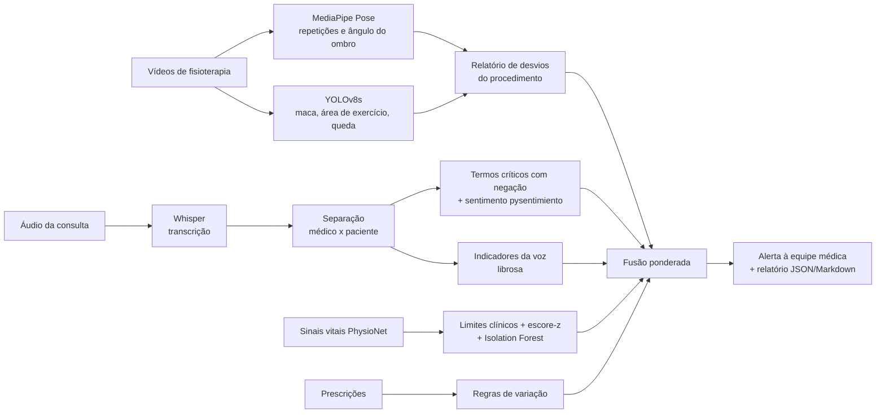
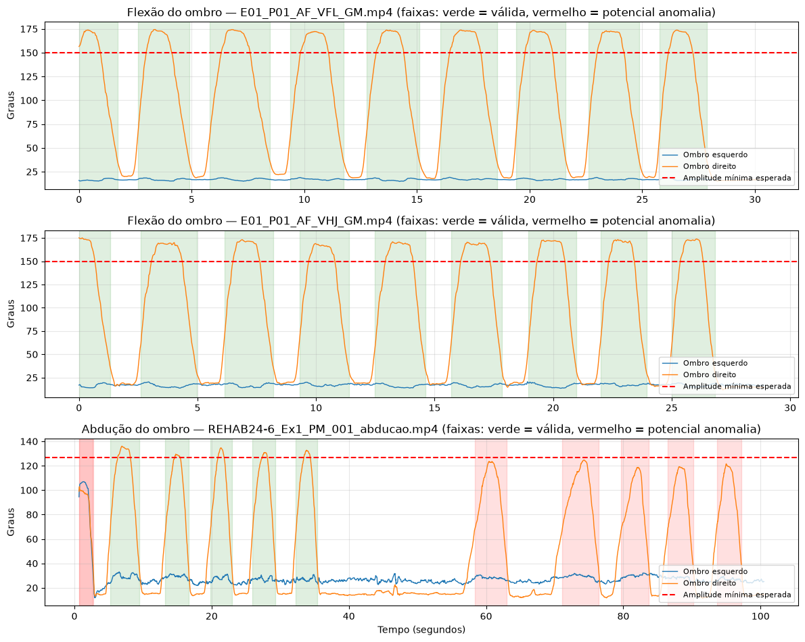
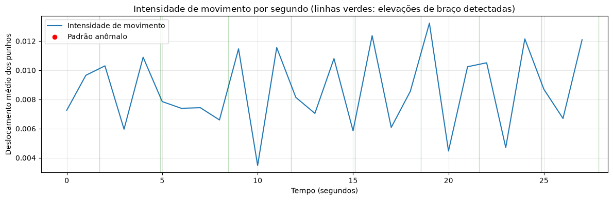
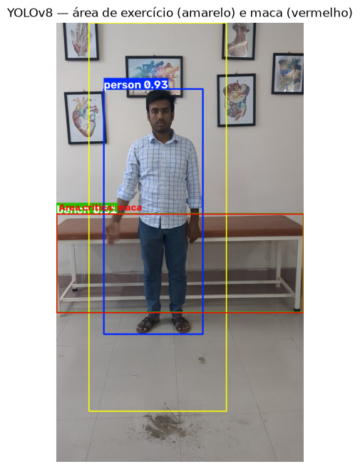
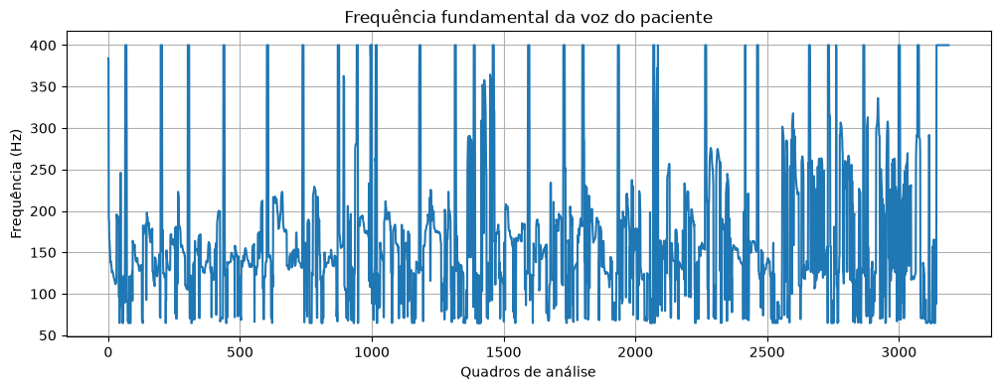
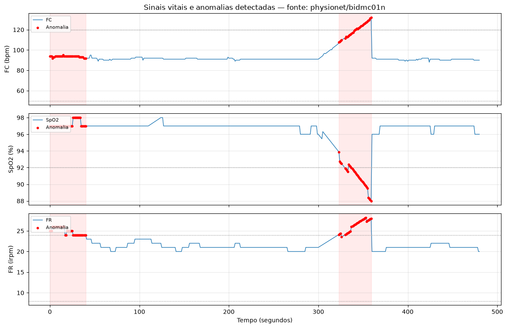
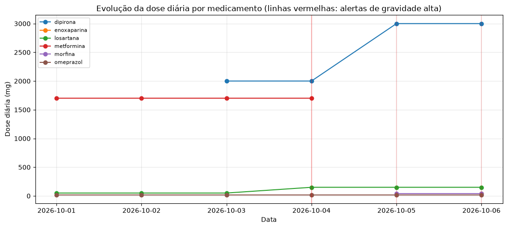

# Tech-Challenge-04-2026

## Link do vídeo de demonstração

# Relatório Técnico

## 1. Visão Geral da Solução

Nesta fase, o desafio foi monitorar o paciente de forma contínua usando dados de tipos diferentes (vídeo, áudio, texto e dados clínicos) para identificar sinais precoces de risco. O projeto foi dividido em quatro etapas principais:

1. **Análise de vídeo:** processamento de vídeos de sessões de fisioterapia para identificar movimentos executados fora do padrão esperado e eventos críticos na cena.

2. **Análise de áudio:** transcrição de uma consulta médica, separação das falas do médico e do paciente, identificação de termos críticos e análise de características da voz e do sentimento do relato.

3. **Detecção de anomalias:** aplicação de técnicas de detecção de anomalias em séries temporais de sinais vitais, na evolução das prescrições e nos padrões de movimentação do paciente.

4. **Fusão e alerta:** consolidação das evidências de todas as modalidades em um único nível de alerta (verde, amarelo ou vermelho), com justificativas e envio para a equipe médica.

Todo o fluxo foi desenvolvido no notebook `Monitoramento_Multimodal_Entregavel.ipynb`, pensado para rodar no Google Colab com GPU T4.

## 2. Fluxo Multimodal

## 3. Modelos Aplicados em Cada Tipo de Dado

| Tipo de dado | Modelo / técnica | Por quê |
|---|---|---|
| Vídeo (postura) | **MediaPipe Pose Landmarker** | Equivalente leve ao OpenPose, roda no Colab sem precisar compilar nada e entrega 33 pontos do corpo por quadro |
| Vídeo (objetos e áreas críticas) | **YOLOv8s** (Ultralytics) | Detecta pessoa e objetos da cena (maca), permitindo regras de área de exercício, ausência e possível queda |
| Vídeo (movimentação) | **Isolation Forest** + escore-z | Detector não supervisionado, não precisa de exemplos rotulados de anomalia |
| Áudio | **OpenAI Whisper** (medium na GPU) | Transcrição local de boa qualidade em português, sem custo de API |
| Áudio (voz) | **librosa** | Extração de velocidade da fala, pausas, frequência fundamental (pitch) e energia |
| Texto | **Regras com negação** + **pysentimiento** | Identificação de sintomas diferenciando o que foi relatado do que foi negado, e sentimento do relato |
| Sinais vitais | **Limites clínicos**, **escore-z móvel** e **Isolation Forest** | Três detectores complementares combinados por votação |
| Prescrições | **Regras de variação** | Mudanças de dose, frequência, suspensão e medicamentos de alta vigilância |

A integração com o **Azure AI Speech** (transcrição e diarização) e o **Azure AI Language** (sentimento e *Text Analytics for Health*) foi implementada no notebook e é ativada automaticamente quando as credenciais são configuradas nos *Secrets* do Colab. Nesta execução ela não foi habilitada, então os resultados abaixo usam os modelos locais.

---

## 4. Análise de Vídeo

### Vídeos utilizados

| Vídeo | Exercício | Origem |
|---|---|---|
| `E01_P01_AF_VFL_GM.mp4` | Flexão do ombro (braço até acima da cabeça) | Vídeos do grupo |
| `E01_P01_AF_VHJ_GM.mp4` | Flexão do ombro, mesmo exercício em outro ângulo | Vídeos do grupo |
| `REHAB24-6_Ex1_PM_001_abducao.mp4` | Abdução do ombro, com 5 repetições corretas e 5 incorretas | Dataset REHAB24-6 |

Os dois vídeos do grupo mostram apenas execuções corretas. Para conseguir demonstrar que o código pega movimentos executados de forma errada, buscamos um vídeo com execuções incorretas **rotuladas por um fisioterapeuta**, no dataset público REHAB24-6.

### Contagem de repetições e ângulo do ombro
Para cada quadro, o MediaPipe identifica os pontos do corpo. A partir deles, contamos as repetições (o braço sobe e volta à posição inicial) e calculamos o **ângulo de flexão do ombro**, que é o ângulo entre o tronco e o braço. Esse ângulo é uma métrica usada na reabilitação para medir a amplitude do movimento.

Como cada exercício tem uma amplitude-alvo diferente, criamos um **perfil por exercício**:

- **Flexão:** a repetição é válida quando o cotovelo passa acima do olho e o ângulo chega a pelo menos **150°**;
- **Abdução:** a repetição é válida quando o ângulo chega a pelo menos **127°**.

| Vídeo | Repetições | Válidas | Ângulo máximo médio | Intervalo médio | Ritmo |
|---|---|---|---|---|---|
| `E01_P01_AF_VFL_GM.mp4` | 9 | 9 | 173,6° | 3,27 s | Regular (CV 0,061) |
| `E01_P01_AF_VHJ_GM.mp4` | 9 | 9 | 172,1° | 3,19 s | Regular (CV 0,073) |
| `REHAB24-6_Ex1_PM_001_abducao.mp4` | 12 | 5 | 123,4° | 8,59 s | Irregular (CV 0,812) |

### Avaliação contra os rótulos do fisioterapeuta
No vídeo do REHAB24-6, cada repetição tem o rótulo de correta ou incorreta dado pelo fisioterapeuta. Comparamos esse rótulo com o que o nosso sistema classificou:

| | Fisioterapeuta: incorreta | Fisioterapeuta: correta |
|---|---|---|
| **Sistema: potencial anomalia** | 5 | 0 |
| **Sistema: válida** | 0 | 5 |

As repetições corretas chegaram a **129,5° a 136,0°**, e as incorretas pararam em **118,7° a 124,6°**, ou seja, o ângulo do ombro separou bem as duas situações. O sistema também detectou **2 movimentos no início do vídeo** (0,7 s, com os dois braços), antes do protocolo começar, que foram listados como "fora do protocolo".

**Importante:** o limiar de 127° foi calibrado olhando os próprios rótulos desse vídeo. Esse resultado mostra que a métrica consegue separar uma execução certa de uma errada, mas não é uma validação independente. Na prática clínica, a amplitude-alvo é definida pelo fisioterapeuta para cada paciente.

### Padrões de movimentação
A partir da posição dos punhos quadro a quadro, calculamos a intensidade de movimento por segundo e aplicamos um **Isolation Forest** junto com um escore-z, classificando segundos atípicos como **agitação** ou **imobilidade**. A análise considera só a janela do exercício (da primeira à última repetição), já que o repouso antes de começar e depois de terminar não é uma anomalia. No vídeo principal, nenhum segundo foi sinalizado.

### Objetos e áreas críticas com YOLOv8
O YOLOv8 foi aplicado a cada 3 quadros. A **área de exercício** é definida pela posição do paciente no primeiro segundo, e a **maca** é marcada como área crítica. O sistema gera eventos de paciente fora do enquadramento, saída da área de exercício, possível queda e outra pessoa em cena.

Usamos a versão **small** (`yolov8s`) porque a versão nano detectava a maca com apenas 15% de confiança. Com a small, a maca foi detectada em **192 de 303 quadros** e o paciente em todos os quadros. Nenhum evento crítico ocorreu no vídeo, o que é esperado para uma execução normal.

### Relatório automático de desvios
Todos os achados de vídeo são consolidados em uma tabela e no arquivo `relatorio_desvios_video.md`. Nesta execução foram **8 desvios**, todos no vídeo do REHAB24-6:
- 7 de **amplitude incompleta** (as 5 repetições incorretas e os 2 movimentos do início);
- 1 de **ritmo irregular**, causado pela pausa longa entre o bloco de repetições corretas e o bloco de incorretas.

---

## 5. Análise de Áudio

### Áudio utilizado
No lugar de um diálogo sintético, usamos o áudio de uma consulta simulada real: *"Exemplo de uma estação de OSCE com foco na anamnese e comunicação"*, do CDDE da FMRP-USP (2:53 de duração), utilizado exclusivamente para fins acadêmicos. É uma anamnese de **dor no peito**, em que o paciente conta que a dor aparece com esforço e às vezes vai até o pescoço, que já fumou por mais de 20 anos e que nega falta de ar. O notebook ainda permite voltar para o diálogo sintético com `MODO_AUDIO = "sintetico"`.

### Transcrição com Whisper
Usamos o Whisper **medium** quando há GPU disponível. Nos testes, o modelo small errou bastante no áudio real (por exemplo, "desposo" no lugar de "pescoço"), e o medium corrigiu a maior parte desses erros.

### Separação entre médico e paciente
Como médico e paciente falam no mesmo arquivo, as falas precisam ser separadas para analisar só o relato do paciente. Sem o Azure, usamos uma heurística: falas que terminam com pergunta são do médico, e as demais do paciente. O resultado foi de **15 falas do médico e 27 do paciente**, gerando 102 s de áudio só do paciente. Com o Azure habilitado, essa separação é feita pela diarização do Azure Speech, que identifica quem fala em cada trecho.

### Termos críticos com negação
A identificação de sintomas diferencia o que o paciente **relatou** do que ele **negou** (por exemplo, "falta de ar? Não"). Os termos identificados no relato foram:

| Termo | Interpretação |
|---|---|
| Dor no peito | Possível relato de dor torácica |
| Sintoma aos esforços | Sintoma desencadeado por esforço |
| Irradiação da dor | Possível irradiação da dor (até o pescoço) |
| Desconforto abdominal | Possível desconforto epigástrico |
| Tabagismo | Fator de risco |

A combinação de dor no peito com piora aos esforços e irradiação foi tratada como um **padrão sugestivo de dor anginosa**, o que leva o relato para urgência **alta**.

### Características da voz e sentimento
Os indicadores da voz do paciente ficaram dentro do esperado para uma fala normal: **142,9 palavras por minuto**, pitch mediano de **146,3 Hz**, apenas **5,9%** do tempo sem fala e maior pausa de **0,22 s**. Por isso, nenhum alerta de fadiga ou dificuldade respiratória foi gerado pela voz. O sentimento geral do relato foi classificado como **negativo (79,8%)** pelo pysentimiento.

---

## 6. Detecção de Anomalias em Dados Clínicos

### Sinais vitais
Usamos o registro `bidmc01n` da base **BIDMC do PhysioNet**, com frequência cardíaca, saturação de oxigênio e frequência respiratória medidas a cada segundo (481 s). Como o registro é curto e estável, **injetamos um episódio de piora conhecido** entre 300 s e 360 s (frequência cardíaca +40, saturação −8, frequência respiratória +8), para conseguir medir se o detector encontra a anomalia e com qual atraso.

Três detectores são combinados: **limites clínicos** (ex.: SpO2 < 92%), **escore-z móvel** (mudança brusca em relação aos últimos 60 s do próprio paciente) e **Isolation Forest**. Uma amostra é anômala quando viola um limite clínico ou quando pelo menos dois detectores concordam.

| Episódio | Período | Variáveis fora do limite | Gravidade |
|---|---|---|---|
| 1 | 0 s – 40 s | Frequência respiratória (até 26 irpm) | Crítica |
| 2 | 323 s – 359 s | FC (até 132 bpm), SpO2 (até 88%), FR (até 28 irpm) | Crítica |

O episódio 1 está nos dados reais do PhysioNet, e o episódio 2 é o injetado. O detector sinalizou **57% das amostras** do episódio injetado, com **23 s de atraso** até a primeira detecção.

### Evolução de prescrições
Como não existe base pública de prescrições individuais, criamos um histórico simulado de 6 dias e aplicamos regras para detectar alterações inesperadas no tratamento. Foram **7 alertas em 23 prescrições**:

| Data | Medicamento | Alerta | Gravidade |
|---|---|---|---|
| 03/10 | Dipirona | Novo medicamento | Baixa |
| 04/10 | Losartana | Dose diária fora da faixa usual (150 mg/dia) | Alta |
| 04/10 | Losartana | Variação abrupta de dose (+200%) | Alta |
| 05/10 | Dipirona | Alteração de frequência (4x → 6x/dia) | Média |
| 05/10 | Morfina | Novo medicamento de alta vigilância | Alta |
| 05/10 | Metformina | Suspensão abrupta | Média |
| 06/10 | Enoxaparina | Novo medicamento de alta vigilância | Alta |

### Monitoramento em tempo real
Para simular o monitoramento em tempo real, a série de sinais vitais é lida amostra por amostra, e o detector usa apenas o histórico recebido até aquele momento. O alerta é disparado quando a anomalia persiste por algumas leituras seguidas, evitando alarmes por ruído pontual.

---

## 7. Fusão e Alerta à Equipe Médica

As evidências de todas as modalidades são somadas por pesos:

| Evidência | Pontos |
|---|---|
| Desvio de vídeo (baixa / média / alta gravidade) | 0,5 / 1 / 2 |
| Alerta vocal | 1 |
| Relato com urgência média / alta | 2 / 4 |
| Sentimento negativo | 1 |
| Episódio de sinais vitais moderado / crítico | 2 / 4 |
| Alerta de prescrição médio / alto | 1 / 2 |

O nível de alerta é **VERMELHO** quando existe uma evidência crítica (episódio crítico de sinais vitais, relato de urgência alta ou possível queda), ou quando a pontuação chega a 8 com evidências em pelo menos três modalidades. É **AMARELO** a partir de 3 pontos, e **VERDE** nos demais casos.

### Resultado
O caso foi classificado como **🔴 VERMELHO, com 31 pontos**, e evidências em quatro modalidades: vídeo, texto, sinais vitais e prescrições. Entre as justificativas estão o relato com padrão sugestivo de dor anginosa, os dois episódios críticos de sinais vitais, a dose de losartana triplicada e a introdução de morfina e enoxaparina.

O alerta é formatado como mensagem para a equipe, registrado em `alertas_enviados.jsonl` e pode ser enviado para um canal externo (Microsoft Teams ou Slack) configurando a variável `WEBHOOK_URL`. Ao final, o notebook gera `relatorio_alertas.json` e `relatorio_tecnico.md` com todas as evidências.

---

## 8. Desafios Enfrentados

- **Conflito de dependências no Colab:** o `gTTS` exige uma versão antiga da biblioteca `click`, que conflita com o `spacy` instalado pelo `pysentimiento`. Resolvemos removendo o `gTTS`, centralizando tudo em uma única célula de instalação e reiniciando a sessão depois dela.
- **Nomes dos sinais do PhysioNet:** os sinais vêm com vírgula no final do nome (ex.: `"HR,"`), o que deixava a tabela de sinais vitais vazia e quebrava toda a parte de anomalias e alertas.
- **Expressão de "dor no peito":** a regra original nunca reconhecia "dor no peito", apenas "dores no peito".
- **Negação atravessando frases:** em "Dor no peito não, mas sinto meu coração acelerar", a palpitação era marcada como negada. Limitamos a análise de negação à oração atual.
- **Amplitude diferente por exercício:** a regra de cotovelo acima do olho funciona para a flexão, mas na abdução o braço vai só até ~130°. Por isso criamos os perfis por exercício.
- **YOLOv8 nano não detectava a maca:** trocamos para a versão small.
- **Falso alerta de imobilidade:** o repouso no fim do vídeo era sinalizado como imobilidade. Limitamos a análise à janela do exercício.

## 9. Limitações

- Os limiares são experimentais e precisariam ser calibrados com dados reais e validação clínica.
- O limiar de abdução (127°) foi calibrado com os rótulos do próprio vídeo avaliado.
- Os vídeos de flexão e o de abdução são de pessoas diferentes; a fusão os trata como sessões de um mesmo paciente apenas para fins de demonstração.
- O áudio é de uma consulta simulada com atores, e não de um paciente real.
- O Whisper medium não transcreveu os primeiros ~30 s da consulta (apresentação e identificação do paciente), e o histórico familiar de problema cardíaco não foi captado por erro de transcrição.
- Sem o Azure, a separação de falas é feita por uma heurística, e algumas falas finais do médico foram atribuídas ao paciente.
- No monitoramento em tempo real, como os valores do PhysioNet são inteiros e quase constantes, o desvio padrão da janela fica próximo de zero e o escore-z explode, gerando alguns alertas falsos (8 alertas no total).
- O histórico de prescrições é simulado, e o episódio de sinais vitais foi injetado em dados reais.

---

## Como Executar

1. Abra `Monitoramento_Multimodal_Entregavel.ipynb` no Google Colab com GPU T4 (*Ambiente de execução → Alterar tipo de ambiente → T4 GPU*).
2. Os arquivos de entrada estão na raiz deste repositório: os vídeos `E01_P01_AF_VFL_GM.mp4`, `E01_P01_AF_VHJ_GM.mp4` e `REHAB24-6_Ex1_PM_001_abducao.mp4`, o arquivo de rótulos `REHAB24-6_Segmentation.csv` e o áudio `consulta_osce_fmrp.m4a`. Envie-os para `/content` ou para o Google Drive (com `MONTAR_DRIVE = True`). Se o áudio não for encontrado, o notebook tenta baixá-lo automaticamente.
3. Execute a célula de instalação e depois **Ambiente de execução → Reiniciar sessão**.
4. Execute o restante do notebook em sequência.
5. (Opcional) Para habilitar o Azure, cadastre nos *Secrets* do Colab: `AZURE_SPEECH_KEY`, `AZURE_SPEECH_REGION`, `AZURE_LANGUAGE_KEY` e `AZURE_LANGUAGE_ENDPOINT`.

## Referências

- **REHAB24-6:** Černek, A.; Sedmidubsky, J.; Budikova, P. *REHAB24-6: Physical Therapy Dataset for Analyzing Pose Estimation Methods*. SISAP 2024. Zenodo, DOI [10.5281/zenodo.13305826](https://zenodo.org/records/13305826) (CC BY-NC 4.0).
- **BIDMC PPG and Respiration Dataset:** PhysioNet, [physionet.org/content/bidmc](https://physionet.org/content/bidmc/1.0.0/).
- **Consulta simulada:** *Exemplo de uma estação de OSCE com foco na anamnese e comunicação*, CDDE – FMRP-USP, [YouTube](https://www.youtube.com/watch?v=-BsAJyoj_Kw).

## Conclusão

Concluímos que a combinação de diferentes tipos de dados torna o monitoramento mais confiável do que olhar cada fonte isoladamente. Neste caso, o relato do paciente sozinho já indicava urgência alta, mas a fusão com os sinais vitais e as prescrições reforçou o alerta e deixou claro para a equipe **por que** o paciente precisa de atenção.

Na análise de vídeo, o ângulo do ombro calculado a partir do MediaPipe mostrou ser uma métrica simples e eficiente para separar execuções corretas das incorretas, acertando as 10 repetições rotuladas pelo fisioterapeuta. Mesmo assim, como o limiar foi calibrado com o próprio vídeo, o próximo passo seria validá-lo com mais pacientes.

O sistema serve como uma **ferramenta de apoio à triagem e ao monitoramento**. Ele acelera a identificação de sinais de risco e organiza as evidências, mas o médico e o fisioterapeuta continuam tendo a palavra final na avaliação do paciente.
